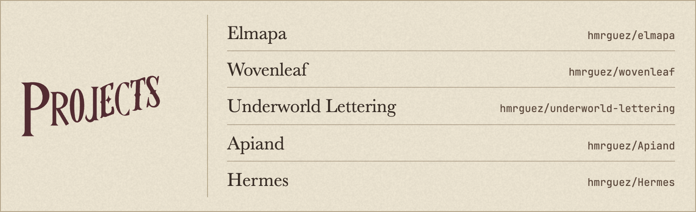

<picture><source media="(max-width: 600px)" srcset="assets/masthead-mobile.png"></picture> 
<picture><source media="(max-width: 600px)" srcset="assets/contributions-mobile.png"></picture> 
<picture></picture> <picture></picture> 
<a href="https://github.com/hmrguez?tab=repositories"><picture><source media="(max-width: 600px)" srcset="assets/projects-mobile.png"></picture></a>
