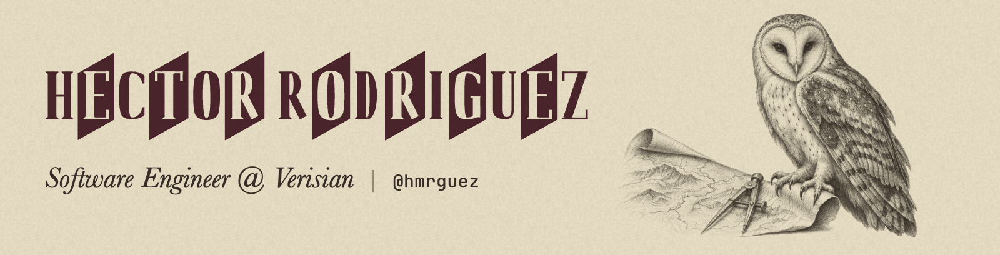
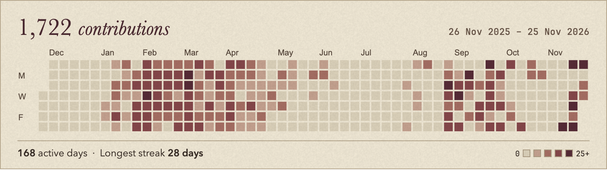
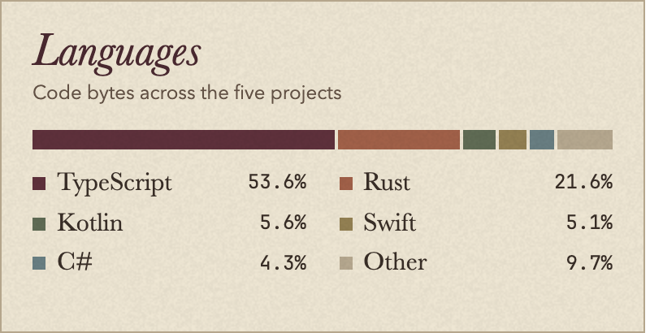
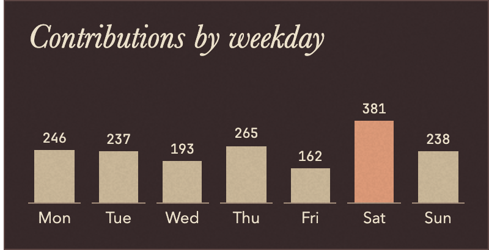
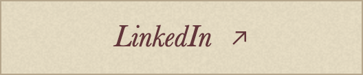
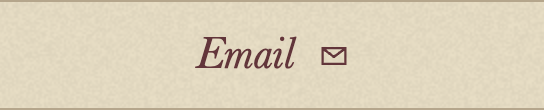
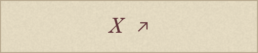

<picture><source media="(max-width: 767px)" width="100%" srcset="assets/masthead-mobile.png"></picture> 
<picture><source media="(max-width: 767px)" width="100%" srcset="assets/contributions-mobile.png"></picture> 
<picture><source media="(max-width: 767px)" width="100%" srcset="assets/languages-mobile.png"></picture><picture><source media="(max-width: 767px)" width="100%" srcset="assets/weekday-mobile.png"></picture> 
<a href="https://github.com/hmrguez?tab=repositories"><picture><source media="(max-width: 767px)" width="100%" srcset="assets/projects-mobile.png"></picture></a> 
<a href="https://www.linkedin.com/in/hmrguez"><picture><source media="(max-width: 767px)" width="33%" srcset="assets/linkedin-mobile.png"></picture></a><a href="mailto:zealot.algo@gmail.com"><picture><source media="(max-width: 767px)" width="34%" srcset="assets/email-mobile.png"></picture></a><a href="https://x.com/MachineZealot"><picture><source media="(max-width: 767px)" width="33%" srcset="assets/x-mobile.png"></picture></a>

